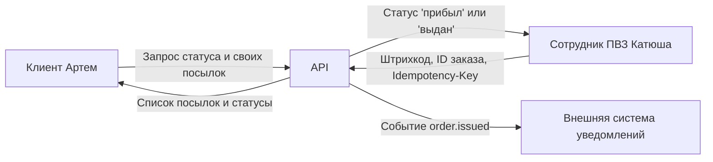

# ПР № 1. Паспорт темы: Пункт выдачи заказов 

Студент: Косульникова Екатерина Сергеевна

Группа: ДЭ 15-25

Профиль: prb

Тема: pvz

Статус: готово к защите

## Паспорт темы

1. **Код темы:** pvz
2. **Заказчик:** Выдуманная компания «New_Wave»; сотрудники ПВЗ принимают и выдают посылки, а клиенты отслеживают свои заказы.
3. **Кто вызывает:** API вызывают две стороны: Сотрудник ПВЗ и Клиент. У каждого свой ключ доступа.
4. **Ресурсы:** Заказы, Ячейки хранения.
5. **Состояния:** Заказ: ожидает в пути (in_transit) → прибыл в ПВЗ (arrived) → выдан клиенту (issued) или возвращен отправителю (returned).
6. **Четыре сценария:** 
   - Принять посылку на склад ПВЗ;
   - Получить список посылок, ожидающих выдачи;
   - Выдать заказ клиенту;
   - Оформить возврат посылки.
7. **Правило повтора:** Повторный вызов «Выдать заказ» с тем же Idempotency-Key не должен выдавать вторую копию товара, не должен менять статус заказа, если он уже «выдан», и не должен повторно списывать деньги за хранение.
8. **События:** order.arrived (посылка пришла), order.issued (посылка выдана клиенту).
9. **Вне работы:** Логистика, работа курьеров,печать этикеток и работа сканеров, написание числа ячейки на товаре, упаковка товара.

**Приёмка:** Клиент не видит посылки других клиентов; повторное нажатие «Выдать» не выдает товар дважды; попытка выдать посылку, которая еще не прибыла в ПВЗ, отклоняется.

## Таблица «кто вызывает»

| Кто | Какую строку-ключ вы для него придумали | Что ему можно | Что ему нельзя |
| :--- | :--- | :--- | :--- |
| Сотрудник ПВЗ (Катюша) | `pvz-staff-key-katusha` | Принимать посылки, выдавать их клиентам, оформлять возвраты, видеть список всех посылок в ПВЗ | Менять статус посылки на «выдана» без присутствия клиента  |
| Клиент (Артем) | `pvz-client-key-artem` | Видеть статус и список только своих посылок, получать код выдачи | Видеть чужие посылки, вручную менять статус заказа в базе, принимать посылки на склад |

## Таблица сценариев

| № | Сценарий | Что присылают | Что получают | Когда отказывают |
| :--- | :--- | :--- | :--- | :--- |
| 1 | Принять посылку в ПВЗ | Штрихкод посылки | Статус «прибыл в ПВЗ» и номер ячейки | Посылка с таким ID уже есть в ПВЗ; ячейеек не хватает; штрихкод не читается |
| 2 | Список своих посылок | Токен клиента и номер страницы | Список только его посылок | Нет авторизации; неверный токен; запрос чужого ID |
| 3 | Выдать заказ | ID заказа, код из СМС, Idempotency-Key | Статус «выдан», чек | Заказ уже выдан; код из СМС не тот; заказ еще в пути |
| 4 | Оформить возврат | ID заказа, причина возврата | Статус «возвращен» | Заказ уже выдан клиенту; заказ уже возвращен |

## Схема

